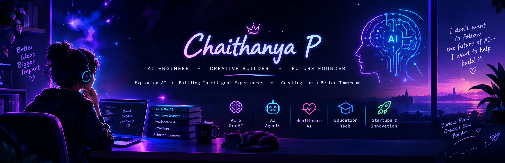

 

# ✦ CHAITHANYA P ✦

### AI Engineer • Creative Builder • Future Founder

**Curious mind. Creative soul. Builder of intelligent things.**

---

## 🧠 Beyond the Code

I'm a BCA student exploring the intersection of **Artificial Intelligence, creativity, and real-world problem solving.**

- 🤖 Exploring AI, Generative AI and intelligent agents
- 💡 Turning unusual ideas into practical applications
- 🏥 Interested in AI for healthcare and education
- 🚀 Building projects, experimenting and learning every day
- 🎨 Bringing creativity into technology

> I don't want to follow the future of AI — I want to help build it.

## ⚡ My Current Universe

| Project | Mission |
|---|---|
| 🛡️ SmartCare AI | Exploring AI-powered elderly safety |
| 🔄 Skill Swapper | Helping students exchange skills |
| 🎲 Random Name Picker | A simple interactive web app |
| 🩺 AI Health Report | Making health information easier to understand |

## 🛠️ Technologies I'm Exploring

## 📊 My GitHub Activity

---

### 🌱 Always learning. Always creating.

*The best ideas begin with curiosity.* ✨

